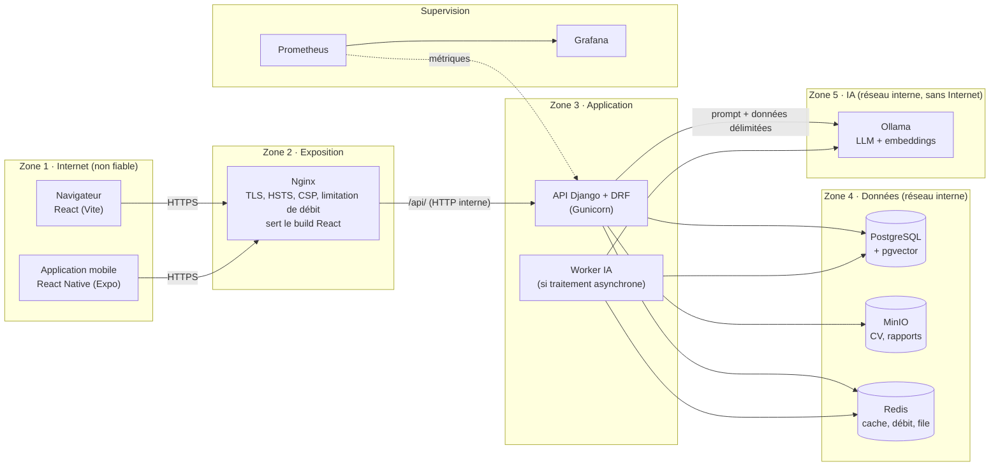

# Architecture — Plateforme de gestion des stages / PFE

Ce document décrit **comment** la plateforme est construite et **pourquoi** ces choix ont été faits.
Le besoin est dans [PRD.md](PRD.md), les règles de code dans [RULES.md](RULES.md), les risques dans
[OWASP.md](OWASP.md). Les diagrammes détaillés (classes, séquences, déploiement, DFD) sont dans
[`conception/`](conception/).

Version 0.2. Toute décision d'architecture s'ajoute au journal (section 9) par PR.

Ce document décrit l'architecture **cible de production**. Le code actuel est un socle en cours de
développement : utilisateur personnalisé, permissions de rôle, pagination, configuration Redis,
CI PostgreSQL et clients web/mobile initialisés en TypeScript. Les endpoints métier, les parcours
web/mobile, Nginx, MinIO, l'IA et la supervision restent à livrer. Les critères de sortie sont dans
[ROADMAP.md](ROADMAP.md).

## 1. Vue d'ensemble

Un seul point d'entrée exposé (Nginx) ; tout le reste vit sur des réseaux internes. Seuls les flux
explicitement représentés sont autorisés ; ils définissent les frontières de confiance du threat model.



| Composant | Technologie | Rôle | Exposé ? |
| --- | --- | --- | --- |
| Web | React + Vite (TypeScript) | Interface des 5 rôles | Fichiers statiques servis par Nginx |
| Mobile | React Native + Expo (TypeScript) | Interface de l'étudiant | Application installée |
| Reverse proxy | Nginx | TLS, en-têtes de sécurité, limitation de débit, routage | **Oui, seul composant exposé (443)** |
| API | Django 5.2 LTS + DRF, Gunicorn | Authentification, autorisation, logique métier, audit | Non (derrière Nginx) |
| Base de données | PostgreSQL + extension pgvector | Données métier + vecteurs du RAG | Non |
| Stockage de fichiers | MinIO (compatible S3) | CV et rapports | Non |
| Cache | Redis | Compteurs de limitation de débit partagés, file de tâches | Non |
| IA | Ollama | LLM local et modèle d'embedding | Non, et sans accès Internet |
| Supervision | Prometheus + Grafana | Métriques, tableaux de bord, alertes | Non (accès équipe uniquement) |

## 2. Flux de données

Les flux élémentaires et les parcours composés ci-dessous servent de base au DFD et au STRIDE.

| # | Flux | Protocole | Contrôles de sécurité |
| --- | --- | --- | --- |
| F1 | Client → Nginx | HTTPS | TLS 1.2 minimum, HSTS, CSP, limitation de débit par IP |
| F2 | Nginx → API | HTTP interne | En-tête `X-Forwarded-Proto`, taille de requête limitée, `/admin/` restreint |
| F3 | API → PostgreSQL | TCP interne | ORM uniquement, utilisateur de base sans droits d'administration |
| F4 | API → MinIO | HTTP interne (S3) | Fichier validé avant l'envoi, nom régénéré, compte de service dédié |
| F5 | API → Ollama | HTTP interne | Entrées limitées en taille, délai d'attente, sortie validée par schéma |
| F6 | API → Redis | TCP interne | Mot de passe, compteurs techniques à durée de vie limitée, aucun contenu métier |
| F7 | Admin → base documentaire | Via F1-F3 | Rôle administrateur, ajout journalisé, documents étiquetés par rôle |
| F8 | Prometheus → API | HTTP interne | Endpoint de métriques non routé par Nginx |

## 3. Authentification et autorisation

**Authentification**

| Client | Mécanisme | Détails |
| --- | --- | --- |
| Web | Session Django | Cookie `HttpOnly`, `Secure`, `SameSite=Lax` + jeton CSRF. Aucun jeton en `localStorage` |
| Mobile | JWT (djangorestframework-simplejwt) | Jeton d'accès de 15 min, jeton de rafraîchissement avec rotation et liste de révocation, stockés dans `expo-secure-store` |
| Administrateur | Session + MFA obligatoire en production | TOTP proposé (django-otp), méthode à arrêter avant livraison |

Le web et l'API partagent la **même origine** (Nginx : `/` → build React, `/api/` → Django). En
production, CORS est donc inutile, et les cookies `SameSite` protègent la session.

**Modèle d'utilisateur** : un modèle `User` personnalisé avec un champ `role` (5 valeurs), créé **avant
la première migration**, comme le recommande Django. Un compte = un rôle. Le socle contient
`accounts.User` et sa migration initiale. Les droits Django `is_staff`/`is_superuser` sont distincts
du rôle métier : attribuer le rôle administrateur n'accorde pas automatiquement ces privilèges.
Les contraintes en base interdisent un rôle inconnu et des privilèges incohérents.
Dans l'admin Django, seul un superutilisateur peut modifier un autre compte `is_staff`, y compris
son mot de passe. Un gestionnaire ne peut attribuer ni permissions Django ni privilèges techniques.

**Autorisation, en 4 couches** (chacune rattrape un oubli de la précédente) :

1. **Rôle** : une permission DRF par action (`EstEtudiant`, `EstAdministrateur`…) — contre BFLA (API5).
2. **Propriété** : `get_queryset()` ne renvoie que les objets de l'utilisateur — contre BOLA (API1).
3. **État** : une action par transition, qui vérifie l'état courant — contre la logique métier (A06).
4. **Base de données** : clés étrangères, contraintes d'unicité et de valeurs — dernière ligne de défense.

La [matrice d'autorisations](conception/matrice-autorisations.md) précise les trois premières couches.
Les permissions de rôle du socle ne remplacent pas le filtrage des objets ni les règles de transition.

## 4. Organisation du backend

Une application Django par domaine, issue des paquets du diagramme de cas d'utilisation. Les
dépendances vont dans un seul sens : une application ne dépend que de celles listées avant elle.

| Application | Responsabilité | Dépend de |
| --- | --- | --- |
| `core` | Sonde de santé, utilitaires communs | — |
| `accounts` | Utilisateur et rôles, inscription, validation des entreprises, tuteurs | `core` |
| `audit` | Journal des actions sensibles | `accounts` |
| `offers` | Offres de stage | `accounts` |
| `applications` | Candidatures, CV | `offers` |
| `agreements` | Conventions | `applications` |
| `internships` | Affectations, rapports, commentaires | `agreements` |
| `evaluations` | Fiche entreprise, note finale | `internships` |
| `assistant` | Score de compatibilité, assistant RAG | `applications`, `offers` |

**Conventions d'API**
- Endpoints métier sous `/api/v1/` ; la sonde reste `/api/health/`.
- JSON ; listes paginées (20 par page, 100 maximum) ; erreurs au format DRF `{"detail": "..."}`,
  sans trace d'erreur.
- Schéma OpenAPI généré par drf-spectacular : contrat d'API, inventaire (API9) et cible du DAST.
  Documentation désactivée par défaut, activée en développement et en CI.

**Cache et quotas** : `CACHE_URL` configure le backend Redis natif de Django ; `REDIS_PASSWORD`
fournit son mot de passe séparément. Compose utilise Redis sur un réseau privé dédié, sans port
publié. Le cache mémoire reste réservé aux tests unitaires et au développement à un seul processus.
`check --deploy` refuse une configuration sans Redis. Les compteurs DRF sont partagés entre workers,
mais ne constituent pas une garantie transactionnelle
en cas de requêtes concurrentes. Le plafond métier R2 est imposé dans PostgreSQL par transaction et
verrouillage de la ligne étudiant, avec des tests concurrents lors de la livraison des candidatures.

## 5. Fichiers

- Envoi : l'API vérifie le type réel (PDF), la taille (5 Mo) et régénère le nom (UUID), puis dépose
  le fichier dans MinIO.
- Téléchargement : **uniquement via l'API**, qui contrôle l'accès et journalise chaque
  téléchargement avant de renvoyer le fichier. MinIO n'est jamais exposé, et aucun lien de
  téléchargement ne circule en dehors de l'application.

## 6. Intelligence artificielle

Les deux fonctionnalités appellent Ollama sur le réseau interne. Le conteneur n'a pas accès à Internet :
le modèle est téléchargé une fois, depuis sa source officielle, puis épinglé (version et empreinte).
Chaque résultat est enregistré avec la **version du modèle et la version du prompt**, pour pouvoir
expliquer et reproduire un score.

**Score de compatibilité (F22)** : texte extrait du CV (taille limitée) + offre → prompt où les
instructions et les données sont séparées → réponse JSON validée par un serializer → score
**consultatif** affiché avec sa justification. Séquence détaillée : `conception/seq-matching-ia.puml`.

**Assistant RAG (F04)** : un administrateur dépose un document → découpage en fragments → embeddings →
stockage dans PostgreSQL avec les rôles autorisés. À chaque question, le filtre par rôle et la recherche
vectorielle se font **dans la même requête**, ce qui empêche un rôle de récupérer un fragment qui ne
lui est pas destiné (LLM09) :

```python
# apps/assistant/models.py (extrait)
from django.contrib.postgres.fields import ArrayField
from pgvector.django import CosineDistance, VectorField

class Fragment(models.Model):
    document = models.ForeignKey(DocumentReglementaire, on_delete=models.CASCADE)
    contenu = models.TextField()
    roles_autorises = ArrayField(models.CharField(max_length=32))
    embedding = VectorField(dimensions=768)  # selon le modèle d'embedding choisi

# Recherche : jamais de fragment hors du rôle de l'utilisateur, même s'il est le plus proche
fragments = (
    Fragment.objects.filter(roles_autorises__contains=[request.user.role])
    .order_by(CosineDistance("embedding", vecteur_question))[:5]
)
```

**Asynchrone** : si un score dépasse 30 secondes (cible du PRD), il passe dans un worker
(Celery + Redis) et l'interface affiche « en cours ». À décider après mesure.

## 7. Déploiement et durcissement

Docker Compose fournit l'environnement de développement local. La préproduction et la production
reprennent les mêmes versions d'images avec leurs paramètres d'exploitation ; l'hébergement reste
à arrêter. Le fichier Compose actuel n'est pas la configuration de production complète.

| Mesure | Application |
| --- | --- |
| Images minimales, utilisateur non-root | Dockerfile du backend (vérifié par Trivy) |
| Conteneurs en lecture seule, `cap_drop: ALL`, `no-new-privileges` | `docker-compose.yml` |
| Réseaux séparés : `public` (Nginx), `app`, `donnees` et `ia` en `internal: true` | Zones 2 à 5 du schéma |
| Limites de CPU et de mémoire, surtout pour Ollama | Contre l'épuisement de ressources (LLM06, API4) |
| Base PostgreSQL avec pgvector | Image `pgvector/pgvector` à la place de `postgres` quand le RAG arrive |
| Secrets | `.env` en local (jamais commité), secrets GitHub en CI |
| Ressources | Prévoir au moins 8 Go de RAM libres pour un modèle de 7-8 milliards de paramètres quantifié |

**CI/CD** : la pipeline est décrite dans le [README](../README.md#pipeline-devsecops). Reste à ajouter
le déploiement continu : images publiées sur GitHub Container Registry, signées (Cosign), puis
déployées en préproduction, puis en production lorsque les critères de livraison sont satisfaits,
avec vérification de santé et retour arrière documenté. L'assistance IA au diagnostic suit le
[protocole DevSecOps IA](DEVSECOPS_IA.md) et ne décide jamais de la réussite d'un contrôle.

## 8. Supervision

| Signal | Source | Alerte (exemple) | Ce que ça peut révéler |
| --- | --- | --- | --- |
| Taux de réponses 403 / 404 par utilisateur | Métriques Django (django-prometheus) | Pic soudain | Un attaquant qui énumère des ID (BOLA) |
| Connexions échouées | Logs `django.security` + audit | Plus de 20 en 5 min pour un compte | Force brute (A07) |
| Réponses 429 | Nginx et DRF | Hausse durable | Abus de ressources (API4, LLM06) |
| Durée des appels au LLM | Métriques de l'application `assistant` | Au-delà de 30 s | Saturation du LLM |
| Actions d'administration | Journal d'audit | Toute action hors des heures prévues | Compte administrateur compromis |

## 9. Journal des décisions

Remplace `MEMORY.md`. Une ligne par décision ; on ne supprime pas une décision, on la remplace par une
nouvelle qui la cite. Les décisions du 10 octobre sont des propositions : elles sont adoptées par la
relecture de la PR qui ajoute ce fichier.

| # | Date | Décision | Raison | Alternative écartée |
| --- | --- | --- | --- | --- |
| D1 | 2026-10-09 | Django 5.2 LTS + DRF | Écosystème Python imposé ; LTS = correctifs de sécurité jusqu'en avril 2028 ; admin, ORM et authentification intégrés | FastAPI ; Django 6.1 (support plus court) |
| D2 | 2026-10-09 | React (Vite) pour le web, React Native (Expo) pour le mobile | Même langage (TypeScript) sur les deux clients | Flutter |
| D3 | 2026-10-09 | Base relationnelle PostgreSQL | Données fortement liées, contraintes et transactions, ORM Django | NoSQL (MongoDB) |
| D4 | 2026-10-09 | pgvector pour le RAG (**proposé, à valider**) | Filtre par rôle dans la même requête SQL ; un service de moins | ChromaDB |
| D5 | 2026-10-07 | LLM local avec Ollama | Aucune donnée personnelle envoyée à un service externe (consigne n°7) | API de LLM externes |
| D6 | 2026-10-09 | 5 rôles, tuteur entreprise distinct du responsable | Réalité métier ; plus de scénarios d'autorisation à démontrer | 4 rôles |
| D7 | 2026-10-09 | uv et `uv.lock` haché | Installations reproductibles et vérifiées sur Windows, macOS et Linux | pip + requirements.txt |
| D8 | 2026-10-09 | Actions GitHub épinglées par SHA de commit | Un tag peut être réécrit (compromission de `trivy-action`, mars 2026) | Tags de version |
| D9 | 2026-10-08 | Dépôt public | Protection des branches et code scanning gratuits | Dépôt privé |
| D10 | 2026-10-10 | Session pour le web, JWT pour le mobile | Cookies `HttpOnly` dans le navigateur ; stockage sécurisé du système sur mobile | JWT partout |
| D11 | 2026-10-10 | Web et API sur la même origine | Pas de CORS en production ; cookies `SameSite` efficaces | Domaines séparés |
| D12 | 2026-10-10 | Fichiers servis par l'API, MinIO jamais exposé | Contrôle d'accès et journalisation à chaque téléchargement | URL signées (règle révisée dans RULES.md) |
| D13 | 2026-10-10 | Modèle `User` personnalisé avec un champ `role` | À créer avant la première migration ; un compte = un rôle | Groupes Django seuls |
| D14 | 2026-10-09 | Produit complet destiné à la production ; phases de livraison sans fonctionnalités facultatives | Orientation confirmée par le propriétaire ; sécurité et exploitation requises avant livraison | Arrêt au parcours de démonstration |
| D15 | 2026-10-09 | Quota de 10 candidatures au statut `soumise`, transaction par étudiant | Définition vérifiable du quota et résistance aux soumissions concurrentes | Comptage côté client ou hors transaction |

## 10. Questions ouvertes

- [ ] Hébergement de préproduction et de production, domaine et ressources pour Ollama.
- [ ] Choix du modèle LLM et du modèle d'embedding, selon la RAM disponible.
- [ ] Traitement asynchrone du score IA : nécessaire ? (à mesurer)
- [ ] MFA des administrateurs : TOTP ?
- [ ] Valider D4 (pgvector) en équipe.
- [ ] Cibles de disponibilité, RPO/RTO, stockage des sauvegardes et responsable d'exploitation.
